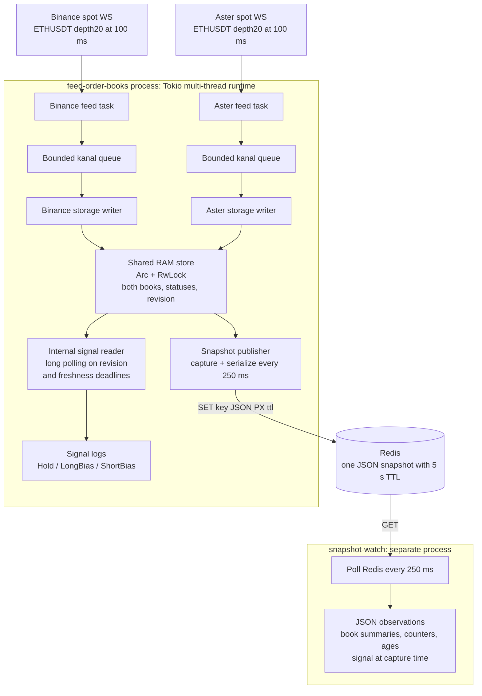

# Feed order books

A Rust service that maintains independent **Binance and Aster spot ETHUSDT order
books**, calculates an explainable signal without placing orders, and publishes
periodic snapshots to Redis. A separate `snapshot-watch` process polls Redis to
show what the service is doing. There is no HTTP server.

## Run the service and see its output

### Local Rust processes

Requirements: Rust 1.95.0 through rustup, a reachable Redis instance, and outbound
TLS access to the public exchange WebSocket endpoints. Docker Compose can start
Redis for you. No exchange account, API key, signature, or private key is needed.
Local native builds also require a C compiler and `make` to build bundled jemalloc.

**No environment variables are mandatory for the supplied local setup.** Run
commands from the repository root so the default `config.yaml` can be found.
Copying `.env.example` is optional.

Terminal 1: start Redis and the feed/signal service.

```sh
docker compose up -d redis
cargo run --release --locked
```

If Redis already runs at `127.0.0.1:6379`, start only the Cargo command. The service
logs feed transitions and `signal` events containing both mid-prices, their
relative difference, feed ages, and a decision.

Terminal 2: run the external snapshot polling process.

```sh
cargo run --release --locked --bin snapshot-watch
```

The observer performs a Redis `GET` every 250 ms by default and prints one JSON
observation per poll. Watch `revision`, `update_id`, and `stats.snapshots` increase;
inspect best bid/ask, the number of retained levels, feed statuses, and ages. Use
`make watch` as a shortcut, or request a single observation:

```sh
cargo run --release --locked --bin snapshot-watch -- --once
```

The observer reports three event types:

| Event | Meaning |
| --- | --- |
| `snapshot` | A snapshot was read; `observation` contains both book summaries and `signal_at_capture` |
| `no_snapshot` | The key does not exist: the publisher may not have started, or its last snapshot expired |
| `observer_error` | Redis access, timeout, JSON, or schema validation failed; continuous polling retries |

`--once` exits after one poll. A missing key is a successful observation;
connection or decoding errors produce a nonzero exit status. Continuous mode
keeps retrying. Both processes support Ctrl+C and SIGTERM.

### Everything in Docker Compose

Start Redis, the main service, and the observer together:

```sh
docker compose --profile observe up --build
```

To start only Redis and the main service, use `docker compose up --build`.
For an additional one-shot observation from an existing app container:

```sh
docker compose exec app snapshot-watch --once
```

Compose supplies `redis://redis:6379/0` to both processes automatically. Redis is
also exposed on `127.0.0.1:6379` for host tools. Stop the stack with
`docker compose down`. For local runs, stop the Rust processes with Ctrl+C; Redis
can remain running to inspect the final snapshot until its TTL expires.

### Inspect the complete exported books

The observer prints a compact summary. The Redis value contains every retained
level on both sides:

```sh
redis-cli --raw GET order-books:ETHUSDT:snapshot
redis-cli PTTL order-books:ETHUSDT:snapshot
```

With containerized Redis, use `docker compose exec redis redis-cli` followed by
the same Redis commands. The main service attempts a final snapshot with
`stopped` statuses and a `hold` decision during graceful shutdown.

## Configuration and environment variables

[config.yaml](config.yaml) contains all required configuration fields and usable
local values. Environment variables are optional overrides. Loading order is:
**process environment > `.env.local` > `.env` > YAML**. `BOOKS_CONFIG` selects the
YAML file, defaulting to `config.yaml` relative to the working directory. Unknown
configuration fields and invalid supported ranges fail startup.

Use [.env.example](.env.example) as an optional template:

```sh
cp .env.example .env.local
```

For a Redis instance on another host or port, change the URL in that file or set
it for each process that should use that Redis:

```sh
BOOKS__APP__REDIS__URL=redis://127.0.0.1:6380/0 cargo run --release --locked
BOOKS__APP__REDIS__URL=redis://127.0.0.1:6380/0 cargo run --release --locked --bin snapshot-watch
```

**Where values come from:** the local Redis URL is supplied below; start that
instance yourself or through Compose. For an existing Redis deployment, obtain
its address, database number, and any credentials from its administrator. Other
values are application tuning choices with defaults in this repository. The
exchange URLs, symbol, depth, and freshness rule are hardcoded in
[model.rs](src/model.rs); there are no exchange credentials to obtain.

All environment overrides are listed here. Every row is **optional** when using
the supplied YAML.

| Variable | Default | Purpose / source |
| --- | --- | --- |
| `BOOKS_CONFIG` | `config.yaml` | Path to the configuration file you maintain |
| `BOOKS__APP__REDIS__URL` | `redis://127.0.0.1:6379/0` | Redis address; your local instance or administrator; Compose overrides the host to `redis` |
| `BOOKS__APP__REDIS__KEY` | `order-books:ETHUSDT:snapshot` | Export key chosen by you; publisher and observer must agree |
| `BOOKS__APP__REDIS__SNAPSHOT_INTERVAL_MS` | `250` | Publisher interval and external observer polling interval |
| `BOOKS__APP__REDIS__TTL_MS` | `5000` | Export lifetime after the latest successful write; must exceed twice the publication interval |
| `BOOKS__APP__REDIS__IO_TIMEOUT_MS` | `1000` | Redis connection/operation deadline |
| `BOOKS__APP__IO__THREADS` | `2` | Main service Tokio worker count; the observer uses its own current-thread runtime |
| `BOOKS__APP__FEED__CHANNEL_CAPACITY` | `32` | Bounded queue size per feed |
| `BOOKS__APP__FEED__CHANNEL_TIMEOUT_MS` | `10` | Queue backpressure deadline; also used for pong flushing |
| `BOOKS__APP__FEED__CONNECT_TIMEOUT_MS` | `10000` | WebSocket connection/handshake deadline |
| `BOOKS__APP__FEED__IDLE_TIMEOUT_MS` | `3000` | Watchdog without valid depth snapshots; must exceed 110 ms |
| `BOOKS__APP__FEED__RECONNECT_INITIAL_MS` | `250` | Initial backoff upper bound before jitter |
| `BOOKS__APP__FEED__RECONNECT_MAX_MS` | `30000` | Maximum local backoff upper bound; server cooldowns may exceed it |
| `BOOKS__APP__FEED__MAX_BAD_FRAMES` | `3` | Consecutive invalid frames before reconnect |
| `BOOKS__APP__SIGNAL__THRESHOLD_BPS` | `2` | Relative mid-price signal threshold, chosen by you |
| `BOOKS__APP__SIGNAL__REPORT_INTERVAL_MS` | `1000` | Maximum intended interval between signal reports, subject to scheduling |
| `BOOKS__LOGS__LEVEL` | `info` | Main service tracing filter, for example `info,feed_order_books=debug` |
| `BOOKS__LOGS__JSON` | `false` | Main service JSON logging; the observer always emits JSON observations |

The observer shares the configuration loader and validates the complete file,
but uses only the Redis settings for its polling work. Its output goes to stdout.

## Architecture and the polling services



The **internal polling service already runs inside the main process**:
[signal::run](src/signal.rs) is started by [run](src/lib.rs). It captures both RAM
books, evaluates the signal, then waits in [Store::wait_for_change](src/store.rs)
for a new revision or a timeout. The timeout is the earlier of a reporting
deadline and the next freshness boundary. `Notify` is registered before checking
the revision to avoid lost wakeups. Silence therefore produces `delayed`/`hold`
even when there is no subsequent market frame.

The **external polling service** is [snapshot-watch](src/bin/snapshot-watch.rs),
using [SnapshotReader::poll](src/observer.rs). It reads the published Redis value
without connecting to either exchange or sharing the main process's memory.
Its output makes publication and independent observation visible. It never
executes a signal or places an order.

Each feed and each storage writer has its own task and queue. One writer owns
each book slot. A single `tokio::sync::RwLock` protects both books and metadata;
a reader clones the two immutable `Arc<OrderBook>` values in one read section,
then releases the lock before calculation, logging, or serialization. Readers
retain their original books while writers publish new ones.

The hot path is: WS frame -> parse/validate at most 40 levels -> per-feed queue
-> replace an `Arc` under the write lock. Redis I/O and export serialization run
in the publisher task. Backpressure retries `try_send_option` with asynchronous
waiting for up to 10 ms. A timeout is observable; failure to deliver even a
failure status terminates the service through its supervisor.

Kanal receive futures run to completion. The writer uses `recv().await`; the
producer exits on shutdown, releases its sender, and closes the channel. See
[Kanal cancellation documentation](https://docs.rs/kanal/0.1.1/kanal/struct.AsyncReceiver.html#method.recv).

## Why publish snapshots when books are in RAM?

There are three related snapshot concepts:

| Snapshot | Producer and consumer | Purpose |
| --- | --- | --- |
| Exchange partial book | Public WS -> feed/storage writer | Replace the selected top 20 levels without applying deltas |
| Local store snapshot | RAM store -> signal reader or publisher | Capture a consistent pair of immutable book references and metadata |
| Published JSON snapshot | Publisher -> Redis -> `snapshot-watch` or another external reader | Expose a portable, atomic view across process boundaries |

**RAM is the source of truth for live decisions. Redis is an external observation
view.** The signal reader can access RAM cheaply; an independent process cannot
access those Rust `Arc` values. Redis provides that process with both books,
statuses, counters, capture time, and the decision calculated from the same
captured state. It also keeps the final exported view briefly after the main
process stops, making `stopped` visible until expiry.

The publisher writes one complete JSON document with `SET ... PX 5000` every
250 ms. There is no tick history or delta log. Both books and the signal are
replaced atomically as one value. The service starts new books from public WS
snapshots after a restart; it does not restore books from Redis. Compose disables
Redis disk persistence, so this setup is an ephemeral observation cache.

Redis failure does not block the local signal reader or feed writers. Redis
connection/operation time is bounded, failed connections are discarded, and
later publication/poll attempts reconnect. The observer displays `observer_error`
during an outage and resumes observations after recovery.

### Capture freshness versus freshness at read time

The export interval of 250 ms exceeds the 110 ms feed freshness limit. A value
can be valid at capture and stale by the time an external process reads it.
`signal_at_capture` and `status_at_capture` in observer output explicitly describe
the historical capture, not a newly evaluated current decision.

For comparable producer/observer wall clocks, the observer estimates:

```text
publication_age_ms = observed_at_ms - captured_at_ms
estimated_age_at_read_ms = age_at_capture_ms + publication_age_ms
```

For example, 40 ms at capture plus 80 ms before reading gives 120 ms: the stored
signal has exceeded the freshness limit even though the key still has TTL.
Future capture timestamps produce `null` age estimates. Clock skew and
millisecond rounding also affect these estimates. An external execution consumer
would need a defined validity contract, clock uncertainty allowance, and a
suitable publication frequency. The observer only reports data. The 5 s TTL
limits how long an abandoned publication remains; it does not certify market
freshness.

## Market streams and book validation

Both markets are **spot**, symbol `ETHUSDT`, up to 20 bid and 20 ask levels,
stream `ethusdt@depth20@100ms`. Constants are in [model.rs](src/model.rs).

| Exchange | Exact public WebSocket URL |
| --- | --- |
| Binance | `wss://stream.binance.com:443/stream?streams=ethusdt@depth20@100ms` |
| Aster | `wss://sstream.asterdex.com/stream?streams=ethusdt@depth20@100ms` |

Both use the combined `stream` + `data` envelope. References:
[Binance partial book depth](https://github.com/binance/binance-spot-api-docs/blob/master/web-socket-streams.md#partial-book-depth-streams),
[Aster spot limited depth](https://github.com/asterdex/api-docs/blob/master/V3%28Recommended%29/EN/aster-finance-spot-api-v3.md#limited-depth-information).

Each message replaces the selected book depth completely. Missing an earlier
message does not corrupt the next valid snapshot; REST initialization and
`U/u/pu` delta continuity checks are unnecessary for this stream type. A full
exchange-wide depth reconstruction would require a different subscription and
synchronization algorithm.

Binance uses `lastUpdateId`; Aster uses `u` and also provides event time `E`.
Update IDs must not decrease within a connection; equal IDs and forward jumps
are accepted. ID tracking resets after reconnect. The parser validates the
stream, any supplied symbol, nonempty sides of at most 20 levels, unique prices,
positive prices/quantities no larger than one billion, and `best_bid < best_ask`.
It sorts levels before publishing. Prices and quantities use `Decimal` and are
serialized as strings.

## Feed freshness and failure states

The local monotonic age starts when a valid WS book frame is received and
includes parsing/queue time. `age > 100 ms + 10 ms` is delayed; exactly 110 ms is
still fresh. This checks local arrival intervals. It does not measure exchange
network latency: Binance partial books do not contain an event timestamp.
Timer handling is subject to Tokio/OS scheduling, and network jitter or low
market activity can cause brief delayed states.

| Status | Meaning |
| --- | --- |
| `connecting` | Establishing the WS connection; old session freshness is invalidated |
| `synchronizing` | Connected, waiting for the first valid partial snapshot |
| `live` | A valid snapshot is present and at most 110 ms old |
| `delayed` | The valid snapshot is older than 110 ms; the signal is `hold` |
| `invalid_frame` | Invalid JSON, levels, or a regressed ID; wait for a valid snapshot |
| `disconnected` | Peer close, EOF, transport/handshake/pong failure, or depth watchdog timeout |
| `reconnecting` | Backoff includes an attempt number, delay, and failure reason |
| `stopped` | Service shutdown |

Pings receive pongs with matching payloads. Ping/pong and invalid frames do not
extend the depth watchdog. Three seconds without a valid book, or three
consecutive invalid frames, causes reconnect. The next valid partial snapshot
restores the book. A handshake has a 10 s deadline. Exponential backoff uses
jitter, an initial upper bound of 250 ms, and a 30 s cap; sessions lasting at
least 30 s reset the backoff counter.

Failed WebSocket handshakes honor the HTTP
[`Retry-After`](https://www.rfc-editor.org/rfc/rfc9110.html#name-retry-after) header, both as seconds
and as an HTTP date. The retry delay is the greater of the local backoff and the
server's requested wait; neither the local cap nor jitter shortens a server
cooldown. HTTP dates use the local wall clock. Missing or malformed headers on
HTTP 429 use a 60 s minimum pause; HTTP 418 (IP ban) uses a 120 s minimum pause.
Other errors without a valid header retain the ordinary exponential backoff.
The reconnect status includes the selected delay and error reason, so it is
visible in logs and Redis snapshots. Shutdown cancels the wait immediately.

A failed exchange retains its old book for diagnosis while its status blocks
active decisions. The other feed continues independently. Unexpected task exits
or panics stop the process with an error. Tasks share a runtime; this is not
isolation from blocking work on every worker.

## Signal algorithm

[signal.rs](src/signal.rs) reads only the RAM store:

```text
mid = (best_bid + best_ask) / 2
relative_mid_bps = (aster_mid - binance_mid) / binance_mid * 10_000
```

With two fresh `live` books, a difference above `+2 bps` produces `long_bias`,
below `-2 bps` produces `short_bias`, and the inclusive interval produces `hold`.
The threshold is configurable. The direction refers to **Binance**: a higher
Aster mid gives a demonstration long bias on Binance. Any unavailable/stale
book or arithmetic overflow produces `hold` with a reason. Old book numbers
remain diagnostic only.

Signal logs are emitted on decision/status changes and at the configured report
interval, subject to scheduling. They include both mids, relative bps, feed
statuses, ages, and revision. The Redis publisher evaluates the same pure
function on its own consistent capture, so its decision agrees with its exported
books rather than an earlier log event.

This is an explainable heuristic. Mid-prices are not executable prices;
commissions, liquidity, slippage, and coordinated execution are outside the
algorithm. No trading or private API endpoints are called.

## Assignment coverage

The [assignment PDF](%D0%A2%D0%B5%D1%81%D1%82%D0%BE%D0%B2%D0%BE%D0%B5%20%D0%B7%D0%B0%D0%B4%D0%B0%D0%BD%D0%B8%D0%B5%20Rust%20Engineer.pdf) is preserved in its original language.

| Requirement | Implementation |
| --- | --- |
| Two independent public depth feeds | Separate Binance/Aster WS tasks, queues, and writers in [lib.rs](src/lib.rs) and [feed.rs](src/feed.rs) |
| An actual order book with a documented market/symbol | Spot ETHUSDT partial depth20; all selected levels retained in RAM and exported |
| Observable failure and recovery | Status/reason, watchdog, bad-frame validation, backoff, and reconnect |
| A hot path without Redis or export serialization per tick | Per-feed parsing and queued RAM updates; publisher runs separately |
| Consistent reader state and an explicit concurrency model | One shared RwLock and immutable Arc books in [store.rs](src/store.rs) |
| A signal based on both stored books with independent freshness | [signal.rs](src/signal.rs), including Hold on failure or delay |
| Decisions with numeric explanations, no execution | Signal logs and exported signal fields; public market-data access only |
| Reviewer access and submission deadline | Arrange repository access and delivery with the reviewer separately |

The requested Tokio, Kanal, anyhow, Redis snapshot export, local Arc/RwLock
storage, hardcoded symbol, and internal long polling choices are included.

## Checks and known limitations

All test implementations are in `tests/`:

| Location | Coverage |
| --- | --- |
| `tests/unit/model.rs` | Exchange payload parsing and book validation |
| `tests/unit/store.rs` | Freshness, immutable captures, and long polling |
| `tests/unit/signal.rs` | Signal decisions, feed failures, and arithmetic bounds |
| `tests/unit/config.rs` | Configuration and local backoff bounds |
| `tests/unit/feed.rs` | Mock WebSockets, reconnect, watchdog, backpressure, and `Retry-After` |
| `tests/unit/observer.rs` | Published schema, capture semantics, and clock skew |
| `tests/unit/common.rs` | Shared fixtures and waiting helpers |
| `tests/redis_snapshot.rs` | Isolated Redis publisher/observer integration |

Unit modules are linked with `#[cfg(test)]` from `src/` to preserve access to
internal functions without making them part of the public API. The Redis test
is a separate integration test and requires `redis-server` in `PATH`.

```sh
cargo fmt --check
cargo clippy --locked --all-targets -- -D warnings
cargo test --locked
# Requires redis-server in PATH; the test starts its own Redis on a free port.
cargo test --locked --test redis_snapshot -- --ignored
cargo build --locked --release
```

Tests cover both payload formats, validation, exact freshness boundaries,
signal directions/thresholds, independent statuses, immutable captures, long
polling, invalid frames, ID regression/reset, reconnect, backpressure, ping/pong,
and the depth watchdog. Observer tests check the actual publisher schema,
capture-only signal semantics, clock skew, and malformed/unsupported exports.
Retry tests check seconds/date headers, missing/malformed headers, server waits
above the local cap, both exchange reconnect loops, and shutdown during a long
cooldown. They use local mock servers and do not generate exchange rate limits.
The Redis integration test covers publisher/observer reads, the observer CLI,
TTL expiry, and reconnect after Redis restart. Ordinary tests use local mock WS
servers; exchange access is not required. CI runs formatting, Clippy, tests, and
the isolated Redis integration test.

Remaining review items:

1. `status_since_ms` is inaccurate after `Live -> Delayed -> Live`: delayed is
   derived during reads, so the recorded live transition timestamp is not
   refreshed on recovery. Current age/status and Hold filtering still work.
2. Binance `!serverShutdown` currently reaches the book parser and becomes
   `invalid_frame` rather than a dedicated shutdown reason and immediate
   reconnect. Explicit control-event parsing is a future improvement.
3. Main service logging uses synchronous stdout. Slow log consumers can delay
   Tokio workers. A bounded nonblocking log writer and latency measurements
   would improve operational behavior.
4. The current internal-storage failure model terminates the process if even a
   failure status cannot be enqueued. Per-feed writer recovery and separate
   status delivery would be needed for stronger failure isolation.
5. Automated simultaneous two-feed failure/slow-Redis stress tests, supervisor
   panic regression tests, long soak runs, and measured hot-path p95/p99 latency
   remain future work. Docker image builds and hosted CI execution should be
   verified in the target delivery environment.

## Design questions and answers

1. **Why do partial books need neither REST initialization nor delta continuity checks?**
   Each valid message is a complete replacement of the selected depth. Missing
   one does not corrupt the next snapshot. A diff stream would instead require
   a REST baseline, buffered updates, continuity checks, and resync on gaps.

2. **What does a consistent read guarantee?**
   Both book references and metadata are captured under one read lock, and the
   retained Arc books remain immutable. This is one local state, not equal
   exchange timestamps. Each book therefore has its own freshness check.

3. **Why 110 ms for freshness and 3 s for reconnect?**
   A decision must stop using a book after its 100 ms update interval plus the
   requested 10 ms tolerance. The 3 s watchdog lets the open connection recover
   from a short pause while the signal remains Hold. Close, network errors, or
   the bad-frame limit can trigger reconnect sooner; pings do not reset depth age.

4. **How should an external reader use 250 ms Redis snapshots?**
   Treat the result as a capture. Account for time elapsed since capture,
   clock uncertainty, and both feed states. A 40 ms book plus 80 ms publication
   age is already 120 ms old. The observer labels historical decisions as
   `signal_at_capture`; a future execution consumer would need its own validity
   contract. TTL indicates export lifetime, not market freshness.

5. **What does LongBias mean, and why is this only a demonstration?**
   The direction refers to Binance. Binance mid 2000 and Aster mid 2002 give
   `+10 bps`, which exceeds the default 2 bps threshold and yields LongBias.
   Aster mid 1998 gives `-10 bps` and ShortBias. The heuristic assumes possible
   price convergence but ignores executable spreads, fees, liquidity, and
   slippage. The assignment permits an explainable toy signal; orders are never
   submitted.

6. **What happens to Binance when Aster disconnects, or when Redis fails?**
   Binance keeps its own feed/writer loop. Aster retains its last book for
   diagnosis, publishes its failure state, and reconnects; the combined signal
   is Hold until both books are fresh and live. Redis failure affects export
   and external observation only. Internal task failure still uses the shared
   fail-fast supervisor described above.

7. **Why is Kanal recv not selected against cancellation?**
   Kanal 0.1.1 documents receive-value loss when cancelling a polled receive
   future. Writers complete `recv().await`; graceful shutdown drops the producer
   and closes the channel. Queue retries use `try_send_option` plus cancellable
   Tokio timer waits rather than cancelling Kanal operations.
